# Form 8824 — flowchart (as the code does it)

IRS rules: `C:\us-tax\new_lines\forms\8824.md`. Code details and deviations: `C:\us-tax\new_knowledge\forms\8824.md`.
Next steps: `C:\us-tax\new_flowcharts\forms\4797.md` (lines 5 / 16) and `schedule-d.md` (lines 4 / 11 / 19).

Each exchange on the Like-kind exchanges form (taxpayer / spouse) is figured by `Form8824Compute.figure`. A ticked
special case blocks (former main home, note received, section 1043) or adds an advisory (multi-asset, D-8824-4 /
D-8824-6); missing or impossible dates, non-real property, U.S. and foreign property and the 45- / 180-day limits block.
An earlier unrelated exchange is dropped with an advisory. Lines 12–25 follow the instructions; line 21 counts only
section 1245 parts (D-8824-2). Investment property's gain goes to Schedule D line 4 / 11; business, rental or
depreciated property goes through a Form 4797 entry (line 5 section 1231 or line 16 ordinary, line 21 to line 16).
A related-party disposition within two years without an exception makes line 24 taxable this year, with no recapture
(D-8824-1).

Main code: `Form8824Compute.java:58-232` (exchanges, figure), `:239-316` (special cases, qualification), `:332-373`
(Form 4797 / Schedule D routing), `TaxReturnComputeService.java:3150-3155`, `:3241-3242`, `:25428-25438`, `:7720`.

```mermaid
flowchart TD
    S([Compute]) --> IN[/"Like-kind exchanges form: taxpayerExchanges, spouseExchanges"/]:::input
    IN --> G{"hasLikeKindExchange Yes?"}
    G -->|no| NONE([No Form 8824])
    G -->|yes| SC{"Special case ticked?"}
    SC -->|"main home, note, section 1043"| FS>FORM_8824_MAIN_HOME, INSTALLMENT_NOTE or SECTION_1043_NOT_SUPPORTED - blocks, D-8824-6]:::flag
    SC -->|"multi-asset"| FM>FORM_8824_MULTI_ASSET_FIGURED_AS_ONE_GROUP advisory - D-8824-4]:::warn
    SC -->|none| DT
    FM --> DT{"Date transferred and acquired entered, not after 2025?"}
    DT -->|no| FDT>FORM_8824_DATE_..._MISSING or AFTER_TAX_YEAR - blocks]:::flag
    DT -->|yes| YR{"Exchange year 2025?"}
    YR -->|"no: related party 2023 or 2024"| P2
    YR -->|"no: unrelated or older"| FE>FORM_8824_EARLIER_YEAR_NOTHING_TO_FILE - left out]:::flag
    YR -->|yes| Q{"Real property both sides, same country, identified in 45 days, received in 180 days?"}
    Q -->|no| FQ>FORM_8824_NOT_REAL_PROPERTY, US_AND_FOREIGN, 45_DAY or 180_DAY - blocks]:::flag
    Q -->|yes| L15["Line 15 = cash + other property + net debt relief - exchange expenses, not below 0"]
    L15 --> L19["Line 17 = 15 + 16; line 18 = basis + unused expenses + net paid; line 19 = 17 - 18"]
    L19 --> L20["Line 20 = max of 0 and min of 15 and 19"]
    L20 --> L21["Line 21 = section 1245 parts only; no section 1250 or 1252-1255 input - D-8824-2"]:::warn
    L21 --> L22["Line 22 = 20 - 21; 23 = 21 + 22; 24 = 19 - 23 or the loss; 25 = 18 + 23 - 15, 25a and 25b by FMV"]
    L22 --> L14["Line 14 other property given up reported like the exchange - D-8824-5"]:::warn
    L22 --> P2{"Related party disposed within 2 years, no line 11 exception?"}
    P2 -->|yes| R24["Line 24 taxable now, no recapture added - D-8824-1"]:::warn
    P2 -->|no| GAIN
    R24 --> GAIN["Sale gain = line 22 + line 14 in exchange year, + line 24 if recognized"]
    L14 --> GAIN
    REL["Not asked: grandparent, trust or estate as related party; replacement sold in by a related party - D-8824-3"]:::oos
    REL -.-> P2
    GAIN --> BUS{"Business or rental use, or any depreciation?"}
    BUS -->|"no, investment"| HOLD{"Held more than 1 year, line 3 to line 4?"}
    HOLD -->|yes| SD11["Schedule D line 11"]:::output
    HOLD -->|no| SD4["Schedule D line 4"]:::output
    BUS -->|yes| F4797[["Synthesized Form 4797 entry"]]
    F4797 --> BH{"Held more than 1 year?"}
    BH -->|yes| L5["Form 4797 line 5 section 1231, line 21 to line 16; netting per spouse - D-4797-2"]:::output
    BH -->|no| L16["Form 4797 line 16 ordinary, Schedule 1 line 4"]:::output
    L5 --> U19["Unrecaptured section 1250 = min of gain and straight-line depreciation, Schedule D line 19 - D-sch-d-1"]:::output
    GAIN --> OUT["form8824s, out_form_8824, Form 8824 preview per exchange; stale attachment note - D-8824-7"]:::output

    classDef input fill:#e3f2fd,stroke:#1565c0
    classDef flag fill:#ffebee,stroke:#c62828
    classDef output fill:#e8f5e9,stroke:#2e7d32
    classDef warn fill:#fff3e0,stroke:#e65100
    classDef oos fill:#f5f5f5,stroke:#9e9e9e,stroke-dasharray: 5 5
```

Deviation ids in the chart: D-8824-1 (later recognition without recapture), D-8824-2 (only section 1245 recapture),
D-8824-3 (related-party scope), D-8824-4 (multi-asset as one group), D-8824-5 (line 14 character), D-8824-6 (blocked
special cases), D-8824-7 (stale attachment note); from other forms: D-4797-2 (per-spouse netting), D-sch-d-1 (§1250
worksheet cap).
