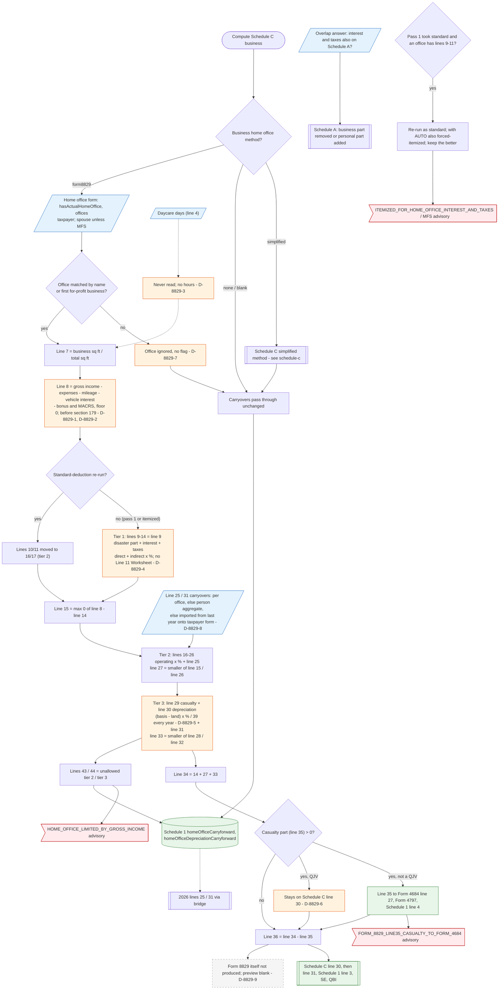

# Form 8829 — flowchart (as the code does it)

IRS rules: `C:\us-tax\new_lines\forms\8829.md`. Code details and deviations: `C:\us-tax\new_knowledge\forms\8829.md`.

For each Schedule C business whose home-office method is "Form 8829 (actual)", the compute matches one home-office
entry (by business name, else the first for-profit business; unmatched entries are silently unused — D-8829-7). The
business percentage is square feet only; a non-exclusive daycare's hours share is ignored (D-8829-3). The income limit
(line 8) is the business's profit before the home office **and before §179** (D-8829-1), with no home-use gains or
location allocation (D-8829-2). Tier 1 (line 9 disaster casualty, mortgage interest, real estate taxes — no Line 11
Worksheet, D-8829-4) is allowed in full; on the standard-deduction re-run it moves into tier 2. Tier 2 (operating
expenses + line 25 carryover) and tier 3 (casualty line 29 + home depreciation at a flat 1/39 — D-8829-5 — + line 31
carryover) are limited in turn. The casualty part (line 35) goes to Schedule 1 line 4 except for a qualified joint
venture (D-8829-6); the rest is Schedule C line 30. Lines 43/44 are stored on Schedule 1 and imported next year onto
the taxpayer's form (D-8829-8). No Form 8829 is produced (D-8829-9).

Main code: `computeHomeOfficeDeduction` (`TaxReturnComputeService.java:28763`), called from `computeScheduleC`
(`TaxReturnComputeService.java:27020`).

Deviation ids in the chart: D-8829-1 (line 8 before §179), D-8829-2 (home-use gains / location allocation),
D-8829-3 (daycare hours), D-8829-4 (Line 11 Worksheet / line 17), D-8829-5 (depreciation percentage, improvements,
Form 4562 line 19j), D-8829-6 (QJV line 35), D-8829-7 (one Form 8829 per business; unmatched office silent),
D-8829-8 (carryover bridge per person), D-8829-9 (Form 8829 not produced). D-8829-10 (labels) is cosmetic and not
drawn.
