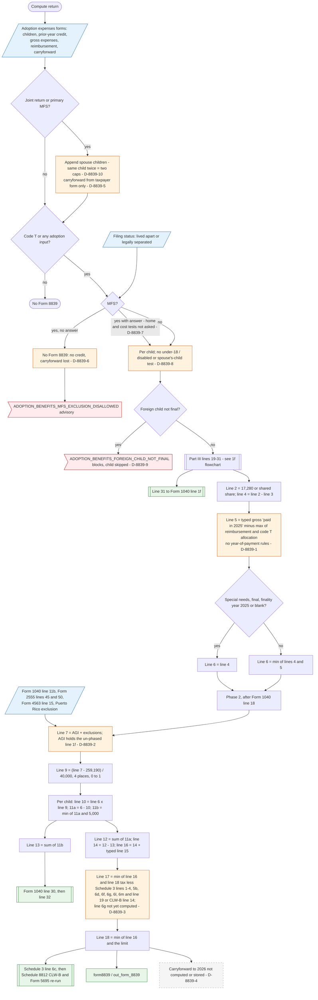

# Form 8839 — flowchart (as the code does it)

IRS rules: `C:\us-tax\new_lines\forms\8839.md`. Code details and deviations: `C:\us-tax\new_knowledge\forms\8839.md`.
Part III in detail: `C:\us-tax\new_flowcharts\1f.md`.

The two "Adoption expenses" forms are merged on a joint return (children appended — the same child twice gets two
caps, D-8839-10 — and only the taxpayer's carryforward kept, D-8839-5). MFS without the lived-apart answer ends with
no Form 8839 at all (no credit, no carryforward, D-8839-6); the answer alone opens it (D-8839-7). Per child: a
foreign child not final blocks (D-8839-9); line 4 = $17,280 (or a shared share) less prior-year amounts; line 5 = the
typed gross expenses (no year-of-payment rules, D-8839-1) less at least the child's code T; a special-needs child
final in 2025 takes line 4. No age / spouse's-child test (D-8839-8). Phase 2 derives MAGI from AGI (which holds the
un-phased line 1f, D-8839-2), applies the fraction, takes up to $5,000 per child as the refundable line 13 (Form 1040
line 30), and limits the rest plus the typed carryforward by the Credit Limit Worksheet (line 6g still empty,
D-8839-3) into line 18 (Schedule 3 line 6c). Nothing is carried to 2026 (D-8839-4).

Main code: `computeAdoptionBenefits` (`TaxReturnComputeService.java:39265-39929`), `applyAdoptionCredit`
(`:44154-44408`), line 30 (`:49900-49918`), `mergeAdoptionForms` (`:38664-38710`).

Deviation ids in the chart: D-8839-1 (expense timing), D-8839-2 (credit MAGI from an un-phased AGI), D-8839-3
(line 6g read before Form 8396), D-8839-4 (no carryforward to 2026), D-8839-5 (spouse carryforward dropped),
D-8839-6 (MFS carryforward lost), D-8839-7 (MFS tests), D-8839-8 (eligible child / spouse's child), D-8839-9
(foreign child not final blocks), D-8839-10 (same child twice on a joint return).
