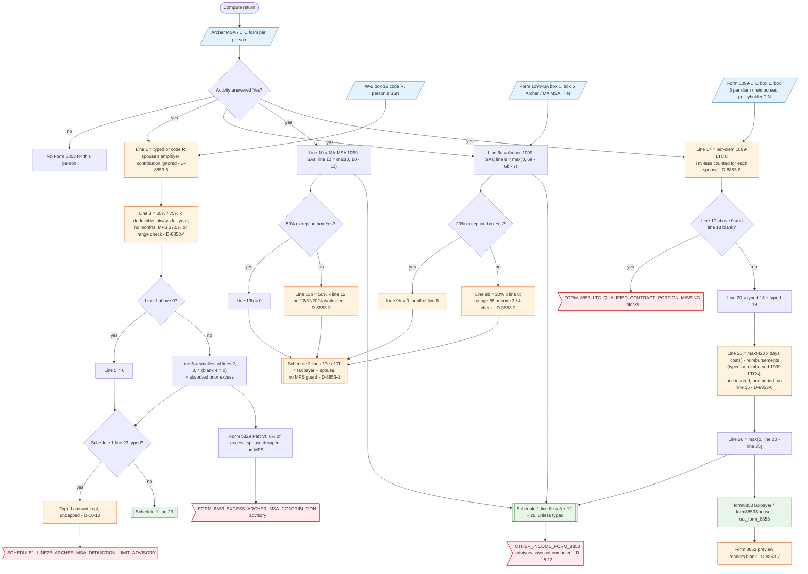

# Form 8853 — flowchart (as the code does it)

IRS rules: `C:\us-tax\new_lines\forms\8853.md`. Code details and deviations: `C:\us-tax\new_knowledge\forms\8853.md`.

Form 8853 is computed once per person who answered Yes on the "Archer MSA / LTC" form. Section A: line 1 is typed or
read from W-2 box 12 code R (only the person's own — D-8853-5); line 3 is always the full-year 65% / 75% of the typed
deductible (months, MFS 37.5% and the deductible range are not handled — D-8853-4); line 5 is the smallest of
contributions, limit and compensation, 0 after any employer contribution, and goes to Schedule 1 line 23 only if
nothing is typed there (D-10-10). Archer distributions (1099-SA box 5 "Archer") less rollovers and medical expenses
give line 8; the 20% tax is all-or-nothing on one checkbox (D-8853-2). Section B taxes Medicare Advantage
distributions at 50% without the worksheet (D-8853-3). Section C takes per-diem 1099-LTCs (TIN-less ones for both
spouses — D-8853-8), blocks if line 18 is blank, and compares the $420-a-day limit or costs less reimbursements with
the qualified per-diem amount, for one insured and one period (D-8853-6). Lines 8 + 12 + 26 go to Schedule 1 line 8e;
lines 9b / 13b go to Schedule 2 lines 17e / 17f summed for both spouses even on MFS (D-8853-1). The preview prints
blank (D-8853-7).

Main code: `computeForm8853` (`TaxReturnComputeService.java:10497`), `computeForm8853FromInputs` (`:9827`), wiring
(`:2958-2980`).

Deviation ids in the chart: D-8853-1 (spouse's MSA taxes on an MFS return), D-8853-2 (20% exception all or nothing),
D-8853-3 (no Additional 50% Tax Worksheet), D-8853-4 (line 3 always full-year, no MFS split), D-8853-5 (spouse's
employer contribution ignored), D-8853-6 (one insured / period, no multiple payees), D-8853-7 (blank preview),
D-8853-8 (TIN-less 1099-LTC counted twice on a joint return), and the recorded D-10-10 and D-8-13.
