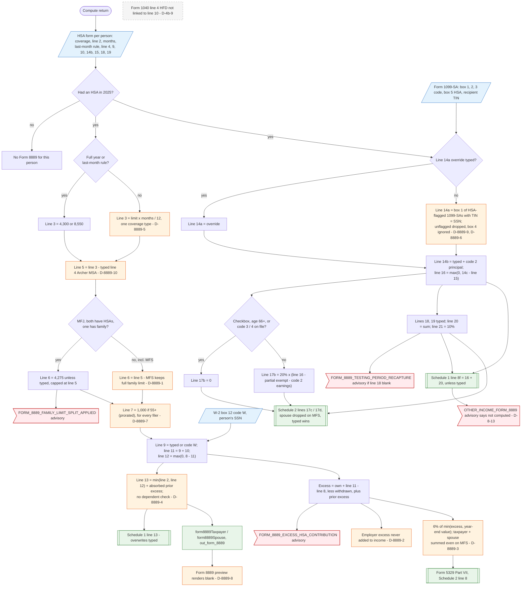

# Form 8889 — flowchart (as the code does it)

IRS rules: `C:\us-tax\new_lines\forms\8889.md`. Code details and deviations: `C:\us-tax\new_knowledge\forms\8889.md`.

Form 8889 is computed once per person who answered Yes to "had an HSA in 2025". Part I takes the $4,300 / $8,550
limit (full year, last-month rule, or prorated by months with one coverage type — D-8889-5), subtracts the typed
Archer MSA amount (D-8889-10), applies the $4,275 family split only on a joint return (D-8889-1), adds the $1,000
catch-up on line 7 for everyone 55+ (D-8889-7), subtracts employer contributions (typed or W-2 box 12 code W) and the
funding distribution, and deducts the smaller of own contributions and the limit — with no dependent check
(D-8889-4). The result overwrites Schedule 1 line 13. Part II sums the person's HSA-flagged 1099-SAs (D-8889-9,
D-8889-6), subtracts rollovers / returned excess and medical expenses, and taxes the rest on Schedule 1 line 8f with
the 20% tax on Schedule 2 line 17c. Part III adds typed testing-period failures (10%, Schedule 2 line 17d). The excess
contribution excise goes to Form 5329 — summed for both spouses even on MFS (D-8889-3), and the employer excess is never
made income (D-8889-2). The preview prints blank (D-8889-8).

Main code: `computeForm8889` (`TaxReturnComputeService.java:9937`), `computeForm8889FromInputs` (`:9613`), wiring
(`:2901-2956`).

Deviation ids in the chart: D-8889-1 (no family split on MFS), D-8889-2 (employer excess not income), D-8889-3
(spouse's excise on an MFS return), D-8889-4 (dependent may deduct), D-8889-5 (no mid-year coverage switch),
D-8889-6 (death / prohibited-transaction distributions), D-8889-7 (catch-up always on line 7), D-8889-8 (blank
preview), D-8889-9 (unflagged 1099-SA dropped), D-8889-10 (line 4 not from Form 8853), and the recorded D-8-13 and
D-4b-9.
