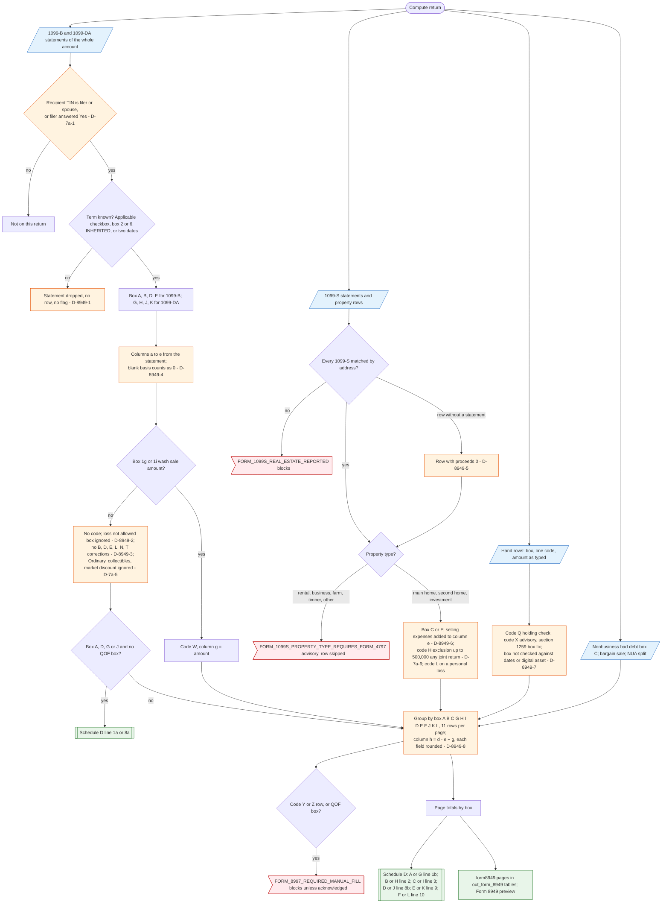

# Form 8949 — flowchart (as the code does it)

IRS rules: `C:\us-tax\new_lines\forms\8949.md`. Code details and deviations: `C:\us-tax\new_knowledge\forms\8949.md`.
Schedule D side: `C:\us-tax\new_flowcharts\forms\schedule-d.md`.

Form 8949 rows come from the account's 1099-B and 1099-DA statements (kept for the filer, the spouse, or — when the
filer answered Yes — anyone else, D-7a-1), the 1099-S property rows, hand-entered rows, nonbusiness bad debt,
bargain sales and NUA splits. The box comes from the "Applicable checkbox", box 2 / box 6, "INHERITED" or the dates;
a statement with no term is dropped (D-8949-1). Only a wash-sale code W is added to a broker row: loss-not-allowed
boxes (D-8949-2), corrections (D-8949-3), Ordinary / collectibles / market discount (D-7a-5) are not, and a blank basis
counts as $0 (D-8949-4). Property rows use box C / F with codes H / L, selling expenses in column (e) (D-8949-6) and
$0 proceeds when no 1099-S matches (D-8949-5). Box A / D / G / J rows with no wash sale and no QOF box go to Schedule D
line 1a / 8a; the rest are paged 11 to a page per box (rounded per field, D-8949-8) and totalled to Schedule D.

Main code: `buildCapitalTransactionsFrom1099B` (`TaxReturnComputeService.java:24900`), `…From1099Da` (`:25029`),
`buildManualTransactions` (`:25067`), `derive1099STransactionsAndEmitFlag` (`:25619`), `derive1099BBox` (`:26172`),
`buildForm8949Pages` (`:26047`).

Deviation ids in the chart: D-8949-1 (statement dropped when the term is unknown), D-8949-2 (loss-not-allowed box),
D-8949-3 (no corrections on broker rows), D-8949-4 (blank basis = 0), D-8949-5 (unmatched property row at $0),
D-8949-6 (one code; selling expenses in column e), D-8949-7 (hand-row box not checked), D-8949-8 (rounding); from
line 7a: D-7a-1 (dependent's statements), D-7a-5 (Ordinary / collectibles / market discount), D-7a-6 (home-sale cap).
