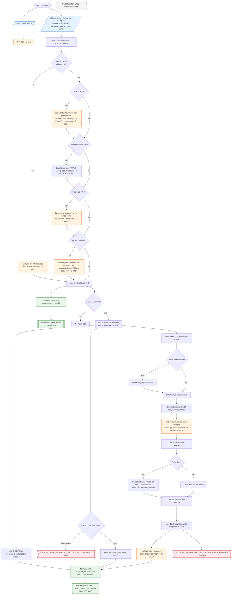

# Form 982 — flowchart (as the code does it)

IRS rules: `C:\us-tax\new_lines\forms\982.md`. Code details and deviations: `C:\us-tax\new_knowledge\forms\982.md`.

The canceled debt is what the user types on the Other incomes forms (taxpayer + spouse; spouse dropped on MFS) —
Form 1099-C box 2 is never read (D-8-2). One method figures the section 108 exclusion in the order title 11 → QPRI →
insolvency → farm → QRPBI. A title 11 Yes on either form excludes everything (D-982-1); QPRI is capped only when the
loan figures are entered (D-982-5); farm and QRPBI amounts are taken as typed with no limit (D-982-2, D-982-3). The
total becomes Form 982 line 2 and is subtracted from Schedule 1 line 8c. After the 2025 tax is figured, Part II
reduces the carryforwards to 2026 — QRPBI against real-property basis (line 4), QPRI against home basis (line 10b),
and the title 11 / insolvency / farm pool through lines 5, 6, 7, 9, 10a or 11a–c, 12 and 13. Line 8 (minimum tax
credit) is skipped (D-982-4).

Main code: `computeCodExclusionBreakdown` (`TaxReturnComputeService.java:31946`), line 8c (`:32356-32375`),
`applySection108AttributeReduction` (`:55370`).

Deviation ids in the chart: D-8-2 (1099-C box 2 not read), D-982-1 (title 11 on either form excludes all of both
spouses' debt), D-982-2 (farm exclusion not limited; leftover not taxed), D-982-3 (QRPBI limits not applied),
D-982-4 (minimum tax credit not reduced), D-982-5 (QPRI uncapped without loan figures).
