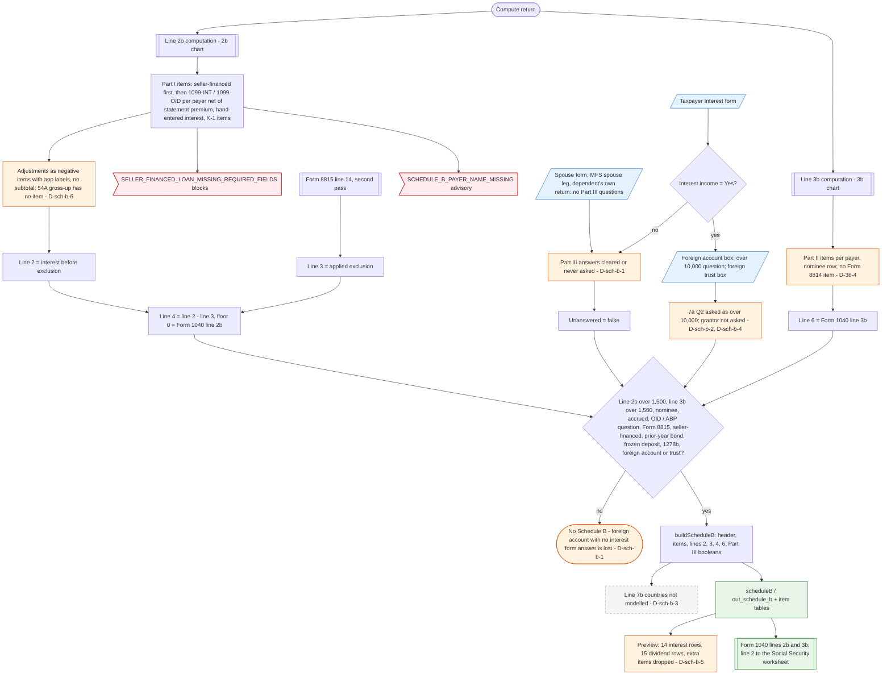

# Schedule B (Form 1040) — flowchart (as the code does it)

IRS rules: `C:\us-tax\new_lines\forms\schedule-b.md`. Code details and deviations: `C:\us-tax\new_knowledge\forms\schedule-b.md`.

The amounts come from the line 2b and 3b computation (`computeInterestIncome`, `computeDividendIncome`; see the
`2b`, `3b` charts). Part I items are listed seller-financed first, then each person's 1099 / hand-entered items with
the adjustments as negative items under app labels and no subtotal (D-sch-b-6), then K-1 items. Line 3 is the Form
8815 line 14 applied on the second compute pass. Schedule B is built only when one of the IRS conditions holds. The
three Part III answers are read only from the taxpayer's Interest form, which shows them only after "interest income"
= Yes; anything unanswered becomes "No" (D-sch-b-1). Line 7b is never collected (D-sch-b-3). The preview draws 14
interest and 15 dividend rows (D-sch-b-5).

Main code: `computeInterestIncome` (`TaxReturnComputeService.java:18875-19160`, triggers `:19077-19101`) and
`buildScheduleB` (`TaxReturnComputeService.java:36163-36179`).

Deviation ids in the chart: D-sch-b-1 (Part III unreachable / defaulted to No), D-sch-b-2 (7a question 2 wording and
blank-vs-No), D-sch-b-3 (no line 7b), D-sch-b-4 (grantor of a foreign trust not asked), D-sch-b-5 (preview row
limit), D-sch-b-6 (adjustment labels, no subtotal, §54A item), D-3b-4 (no Form 8814 item on line 5). Amount
deviations of the feeding lines are on the 2b / 3b charts.
