# Schedule C — flowchart (as the code does it)

IRS rules: `C:\us-tax\new_lines\forms\schedule-c.md`. Code details and deviations: `C:\us-tax\new_knowledge\forms\schedule-c.md`.

For each business on the taxpayer's (and, unless the return is married filing separately, the spouse's) "Business
income (Schedule C)" form, `computeScheduleC` builds gross income: gross receipts (auto-filled from the person's own
1099-NEC + 1099-K when it is their only business and the box is blank — D-sch-c-3, D-sch-c-5, D-1g-3; 1099-MISC is never
read — D-sch-c-4), less returns and cost of goods sold, plus other income (1099-PATR, Form 4797 Part IV recapture). A
not-for-profit activity goes to Schedule 1 line 8j. Expenses, the standard mileage rate, the business share of car-loan
interest and line 13 depreciation (computed assets, else the typed field — D-sch-c-8) give the tentative profit; the
home office (simplified — D-sch-c-6, D-sch-c-7 — or Form 8829) comes off before the section 179 limit is applied
across all businesses and farms (wage figure D-1z-5). Then the §165(d) wagering cap and the at-risk limit run; line G
"No" is ignored (D-sch-c-1). The total goes to Schedule 1 line 3; per-person nets go to Schedule SE, each business to
QBI, and the total to Form 461. No Schedule C form is output (D-sch-c-2).

Main code: `computeScheduleC` (`TaxReturnComputeService.java:26843-27398`), called at `TaxReturnComputeService.java:4051`;
line 3 at `TaxReturnComputeService.java:32256-32266`.

```mermaid
flowchart TD
    S([Compute return]) --> BIZ[/"Business income form: taxpayer;<br/>spouse unless MFS - one entry per business"/]:::input
    NEC[/"1099-NEC box 1 and 1099-K box 1a<br/>matched to the person's SSN"/]:::input
    MISC[/"1099-MISC boxes 3, 5, 6, 7"/]:::input -.-> MISCX["Not read for Schedule C - D-sch-c-4"]:::oos
    BIZ --> GR{"Gross receipts blank and<br/>person has one business?"}
    NEC --> GR
    GR -->|yes| AUTO["Line 1 = 1099 total: personal-item 1099-K amounts,<br/>Form 8919 firm, statutory or hobby target not checked<br/>D-sch-c-3, D-sch-c-5, D-1g-3"]:::warn
    GR -->|no| TYPED["Line 1 = typed gross receipts"]
    AUTO --> MM{"Person's 1099 total differs<br/>from gross receipts?"}
    TYPED --> MM
    MM -->|yes| MMF>SCHEDULE_C_GROSS_RECEIPTS_1099_MISMATCH advisory]:::flag
    MM --> L7["Line 7 = line 1 - line 2 - Part III COGS + line 6<br/>+ 1099-PATR + Form 4797 Part IV recapture"]
    PATR[/"1099-PATR, single business, no farm"/]:::input --> L7
    L7 --> PROFIT{"Operated for profit?"}
    PROFIT -->|no| HOB[["Schedule 1 line 8j - hobby gross income"]]:::output
    PROFIT -->|yes| EXP["Lines 8-27b: expenses, meals 50 or 80 percent,<br/>mileage 0.70 per mile + parking + tolls,<br/>line 16b business share of car-loan interest"]
    ASSETS[/"Depreciable assets matched by business name"/]:::input --> L13{"Any asset matched?"}
    L13 -->|yes| DEP[["Form 4562: bonus + MACRS; section 179 held back"]]
    L13 -->|no| DEPT["Typed line 13; dropped silently once an asset matches - D-sch-c-8"]:::warn
    EXP --> TENT["Tentative profit before home office and section 179"]
    DEP --> TENT
    DEPT --> TENT
    TENT --> HO{"Home office method?"}
    HO -->|simplified| SIMP["5 dollars x min sq ft, 300 per business;<br/>limit before section 179 - D-sch-c-6, D-sch-c-7"]:::warn
    HO -->|form8829| F8829[["Form 8829 three tiers; line 35 casualty to Form 4684"]]
    HO -->|none| NET0
    SIMP --> NET0["Net before section 179"]
    F8829 --> NET0
    NET0 --> S179{"Section 179 elected or carried in?"}
    S179 -->|yes| LIM["Dollar cap, phase-out, business income limit<br/>including all W-2 box 1 in the account - D-1z-5"]:::warn
    LIM --> LIMF>SCHEDULE_C_SECTION_179_LIMITED advisory]:::flag
    LIM --> ALLOC["Allowed section 179 shared over businesses and farms"]
    S179 -->|no| WAG
    ALLOC --> WAG{"Wagering business?"}
    WAG -->|yes| WCAP["Deductions capped at gains - section 165d"]
    WAG -->|no| AR
    WCAP --> AR{"Loss and line 32b with amount at risk?"}
    AR -->|yes| ARCAP[["Form 6198: loss capped, excess carried forward"]]
    AR -->|no| PAS
    ARCAP --> PAS["Line G No is not applied: no Form 8582 - D-sch-c-1"]:::warn
    PAS --> L31["Line 31 per business; QJV split on MFJ<br/>participation not checked - D-sch-c-9"]
    L31 --> L3["Schedule 1 line 3 = sum of line 31<br/>+ Form 8990 adjustment<br/>schedule1.additionalIncome.businessIncomeLoss"]:::output
    L31 --> SE[["Schedule SE line 2 per person - statutory income left out"]]:::output
    L31 --> QBI[["QBI: one component per business"]]:::output
    L3 --> F461[["Form 461 - Schedule 1 line 8p"]]:::output
    L3 --> L9[["Form 1040 line 8, line 9, AGI"]]:::output
    L31 --> PREV["Schedule C preview: blank form, no per-business lines - D-sch-c-2"]:::oos
    W2S[/"Statutory-employee W-2 box 1"/]:::input -.-> W2X["Not carried here; user adds a business - D-1a-4"]:::warn

    classDef input fill:#e3f2fd,stroke:#1565c0
    classDef flag fill:#ffebee,stroke:#c62828
    classDef output fill:#e8f5e9,stroke:#2e7d32
    classDef warn fill:#fff3e0,stroke:#e65100
    classDef oos fill:#f5f5f5,stroke:#9e9e9e,stroke-dasharray: 5 5
```

Deviation ids in the chart: D-sch-c-1 (line G passive ignored), D-sch-c-2 (no Schedule C output), D-sch-c-3 (1099-K
personal items in the auto-fill), D-sch-c-4 (1099-MISC not read), D-sch-c-5 (auto-fill target not checked), D-sch-c-6
(simplified limit before section 179, same root cause as D-8829-1), D-sch-c-7 (300 sq ft per business, no part-year /
daycare), D-sch-c-8 (typed line 13 dropped), D-sch-c-9 (QJV participation not checked). D-sch-c-10 (labels and
advisory direction) is cosmetic and not drawn. Earlier ids: D-1a-4, D-1g-3, D-1z-5.
