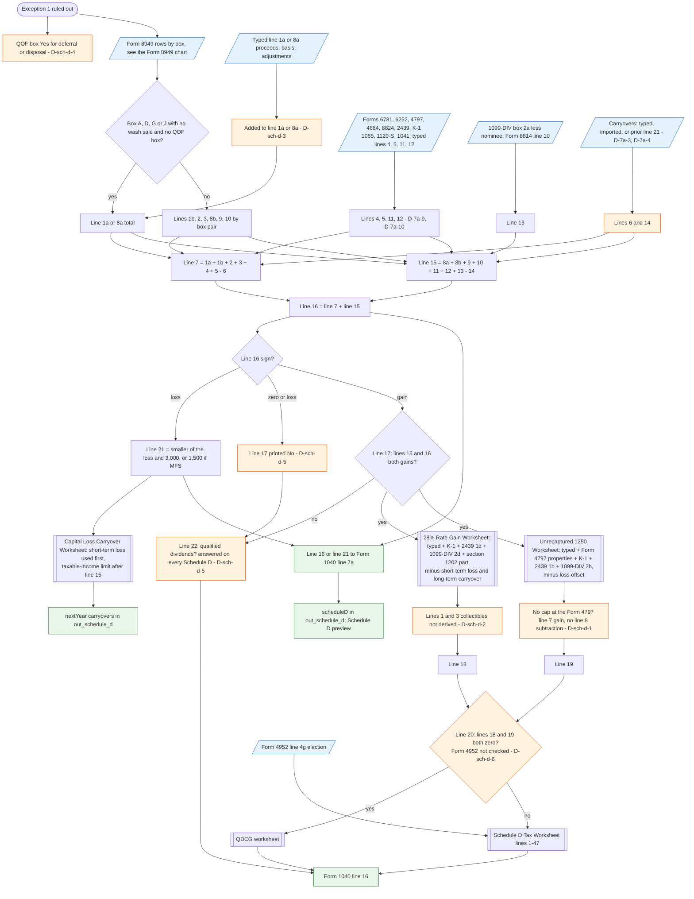

# Schedule D (Form 1040) — flowchart (as the code does it)

IRS rules: `C:\us-tax\new_lines\forms\schedule-d.md`. Code details and deviations:
`C:\us-tax\new_knowledge\forms\schedule-d.md`. Line 7a side: `C:\us-tax\new_flowcharts\7a.md`.

When Exception 1 is ruled out, `computeCapitalGainLoss` builds Schedule D. Lines 1a / 8a take the broker rows in box
A / D / G / J with no wash sale or QOF box, plus typed "not on any broker statement" totals (D-sch-d-3); lines 1b–3 /
8b–10 take the Form 8949 page totals by box. Lines 4 / 5 / 11 / 12 come from Forms 6781, 6252, 4797, 4684, 8824, 2439
and the K-1s; line 13 is box 2a less nominee plus Form 8814 line 10; lines 6 / 14 are the carryovers (D-7a-3,
D-7a-4). Line 16 = line 7 + line 15. A loss is limited to $3,000 ($1,500 MFS) on line 21 and the rest carried to 2026
by the Capital Loss Carryover Worksheet. When lines 15 and 16 are both gains, the 28% worksheet (lines 1 and 3 not
derived, D-sch-d-2) and the §1250 worksheet (no Form 4797 line 7 cap, D-sch-d-1) give lines 18 / 19, and line 20
picks the QDCG worksheet or the Schedule D Tax Worksheet for Form 1040 line 16 (Form 4952 ignored on the printed
answer, D-sch-d-6). Line 17 and line 22 are answered even where the form says skip (D-sch-d-5); the QOF box is Yes
for a deferral too (D-sch-d-4).

Main code: `computeCapitalGainLoss` (`TaxReturnComputeService.java:23515`), lines 18 / 19 (`:23771-23955`),
Schedule D object (`:24110-24178`), carryover (`:25982`, `:6099`), Schedule D Tax Worksheet (`:12227`, `:12354`).

Deviation ids in the chart: D-sch-d-1 (§1250 worksheet lines 7–9), D-sch-d-2 (28% worksheet lines 1 and 3),
D-sch-d-3 (typed line 1a / 8a), D-sch-d-4 (QOF box), D-sch-d-5 (line 17 / 22 answered when skipped), D-sch-d-6
(line 20 ignores Form 4952); from line 7a: D-7a-3, D-7a-4 (carryovers), D-7a-9, D-7a-10 (lines 5 / 11 / 12). Not shown:
D-7a-1, D-7a-5, D-7a-8 (Form 8949 side, see the Form 8949 chart).
