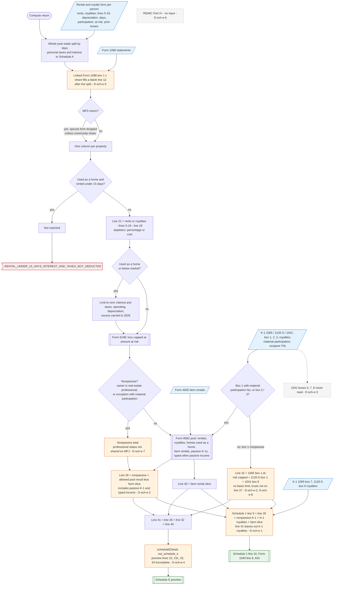

# Schedule E — flowchart (as the code does it)

IRS rules: `C:\us-tax\new_lines\forms\schedule-e.md`. Code details and deviations: `C:\us-tax\new_knowledge\forms\schedule-e.md`.

Before the compute, rental expenses entered as whole-year totals are split by rental / personal days, and only then is
a linked Form 1098 copied into line 12 — so the 1098 interest is never split (D-sch-e-5). Each property on the
"Rental & royalty income" forms (taxpayer and spouse; on MFS the spouse's only by community share) is figured: rented
under 15 days while used as a home → dropped; rents and royalties less lines 5–19 and depreciation / depletion; a home
used as a home is held to its rent with carryovers. The at-risk cap (Form 6198) follows, then the property is classed
nonpassive (real estate professional — the owner only, D-sch-e-7) or put in the shared §469 pool with farm rentals,
passive K-1s and the typed other passive income (Form 8582; royalties and homes used as a home are pooled too —
D-8582-6, D-8582-7). The pool's result is line 26, which therefore also holds passive K-1 amounts (D-sch-e-2). Line 32 is
nonpassive K-1 box 1 of partnerships, S corporations **and** trusts (D-sch-e-2), with no basis limit (D-sch-e-8). Trust
K-1 boxes 5, 7, 8 and REMICs never enter (D-sch-e-3, D-sch-e-6). Line 41 = 26 + 32 + 40, while Schedule 1 line 5 also adds
the K-1 royalties (D-sch-e-1). The preview's per-line detail is incomplete (D-sch-e-4).

Main code: `computeRentalScheduleE` (`TaxReturnComputeService.java:30490`), `computeScheduleEOutput`
(`TaxReturnComputeService.java:31383`), Schedule 1 line 5 (`TaxReturnComputeService.java:32268-32279`).

Deviation ids in the chart: D-sch-e-1 (line 41 vs Schedule 1 line 5, K-1 royalties), D-sch-e-2 (passive K-1 and trust
amounts on the wrong lines), D-sch-e-3 (trust K-1 boxes 5, 7, 8), D-sch-e-4 (preview lines), D-sch-e-5 (Form 1098 after
the days split), D-sch-e-6 (REMIC), D-sch-e-7 (real estate professional on a joint return), D-sch-e-8 (basis limits);
pool classification D-8582-6, D-8582-7 (in `forms\8582.md`).
