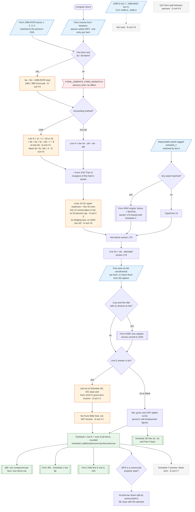

# Schedule F — flowchart (as the code does it)

IRS rules: `C:\us-tax\new_lines\forms\schedule-f.md`. Code details and deviations: `C:\us-tax\new_knowledge\forms\schedule-f.md`.

For each farm on the taxpayer's (and, unless the return is married filing separately, the spouse's) "Farm income
(Schedule F)" form, the app first fills blank cooperative lines of a person's only farm from their Form 1099-PATR
(3b set equal to 3a — D-sch-f-5). Gross income is Part I (cash: 1c + 2 + 3b + 4b + 5a + 5c + 6b + 7 + 8, with no line 6d
— D-sch-f-4, and blank taxable boxes counted as 0 — D-sch-f-5) or Part III (accrual: line 44 less cost of goods sold),
plus Form 4797 Part IV recapture. Typed expenses are subtracted with conservation expenses in full (D-sch-f-3) and no
negative entries (D-sch-f-8); line 14 comes from the depreciable-asset engine (section 179 shared with Schedule C) or
the typed field. The at-risk limit and carryforward run next. Every farm's line 34 adds to Schedule 1 line 6 and to
QBI; only farms whose line E is not "No" reach Schedule SE (D-sch-f-1), and line E "No" never triggers Form 8582 or
NIIT (D-sch-f-2). No Schedule F form is produced (D-sch-f-7). Only Form 1099-PATR is read among farm statements
(D-sch-f-6); a QJV farm is not split (D-sch-f-9).

Main code: `computeFarmIntermediates` (`TaxReturnComputeService.java:27610-27678`), `computeScheduleF`
(`TaxReturnComputeService.java:27686-27780`), called at `TaxReturnComputeService.java:4031` and `:4076`; line 6 at
`TaxReturnComputeService.java:32282-32284`.

Deviation ids in the chart: D-sch-f-1 (line E "No" removes the farm from Schedule SE, EIC and Form 2210-F), D-sch-f-2
(no Form 8582, no NIIT for a passive farm), D-sch-f-3 (no 25% conservation limit or carryforward), D-sch-f-4 (line 6d
missing, deferral amount mislabelled), D-sch-f-5 (taxable boxes and the 1099-PATR fill), D-sch-f-6 (other farm
statements not read), D-sch-f-7 (no Schedule F output), D-sch-f-8 (no negative entries, §263A, prepaid supplies),
D-sch-f-9 (QJV farm not split).
