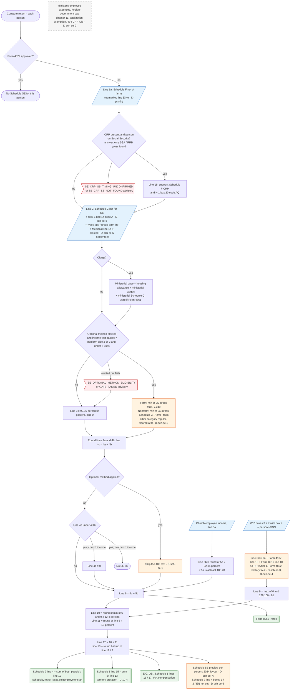

# Schedule SE — flowchart (as the code does it)

IRS rules: `C:\us-tax\new_lines\forms\schedule-se.md`. Code details and deviations: `C:\us-tax\new_knowledge\forms\schedule-se.md`.

`computeScheduleSE` runs once per person (taxpayer, and the spouse unless the return is MFS). A Form 4029 member is
skipped. Line 1a is the Schedule F net of farms not marked line E "No" (D-sch-f-1); line 1b takes off CRP payments when
the person was on Social Security; line 2 is the Schedule C net plus every K-1 box 14 code A (D-sch-se-8), typed
additions and the Medicaid-waiver election (D-sch-se-5), less notary fees, plus the clergy base unless Form 4361 applies.
The regular method multiplies the total by 92.35%; an eligible optional method replaces its category with 2/3 of gross
(capped at $7,240), the other category being floored at zero (D-sch-se-2). Lines 4a, 4b and 4c are rounded; a regular
4c under $400 ends the computation unless there is church income, but an optional amount under $400 is still taxed
(D-sch-se-1). Church income adds line 5b. Line 9 is $176,100 less the person's W-2 boxes 3 + 7, Form 4137 line 10 and
Form 8919 line 10 — no railroad compensation, Form 4852 or territory W-2 (D-sch-se-3, D-sch-se-4). Lines 10 and 11 are
rounded and added into line 12 (Schedule 2 line 4); line 13 is half of line 12 (Schedule 1 line 15). The preview is the
2024 form (D-sch-se-7) and the Schedule 2 line 4 exemption boxes are not set (D-sch-se-6).

Main code: `computeScheduleSE` (`TaxReturnComputeService.java:29128-29496`), called at
`TaxReturnComputeService.java:4087`; Schedule 2 line 4 at `TaxReturnComputeService.java:43880-43886`; Schedule 1
line 15 at `TaxReturnComputeService.java:32872-32874`.

Deviation ids in the chart: D-sch-se-1 (optional amount under $400 taxed), D-sch-se-2 (other category floored at zero),
D-sch-se-3 (no railroad tier 1 on line 8a), D-sch-se-4 (no Form 4852 / territory W-2 on line 8a; same gap as D-1g-5),
D-sch-se-5 (Medicaid-waiver election without a 2025 source), D-sch-se-6 (Schedule 2 line 4 boxes and line A),
D-sch-se-7 (2024 preview), D-sch-se-8 (K-1 farm code A and codes B / C), D-sch-se-9 (special situations not modelled).
Earlier ids: D-sch-f-1, D-10-4.
